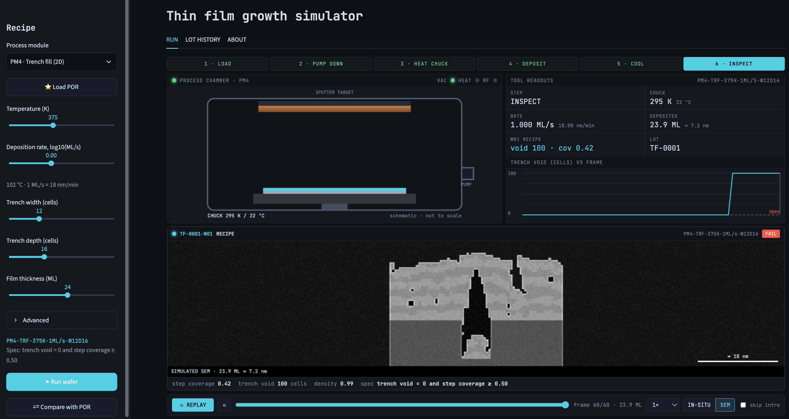

# Where can you find the project demo

[**Open the live project demo**](https://spark-gcp-project-fsxajnsohm7ep7vjgaztix.streamlit.app/)

{width=80% fig-alt="Thin-film growth simulator with recipe controls, a process chamber and a simulated film cross-section."}

# What this project is about

This project makes thin-film growth visible and interactive. It explores how material settles onto a
surface and why a layer that looks solid can still hide an empty pocket underneath. Users can
experiment with different conditions and see how they change the finished film.

# What are some key features

* **Adjustable recipes:** explore different growth conditions and surface shapes.
* **Visual growth and replay:** watch a film form and revisit earlier stages.
* **Film inspection:** examine the finished surface and its cross-section.
* **Recipe comparison:** compare your choices with a reference recipe.
* **Lot history:** review and compare earlier simulation runs.
